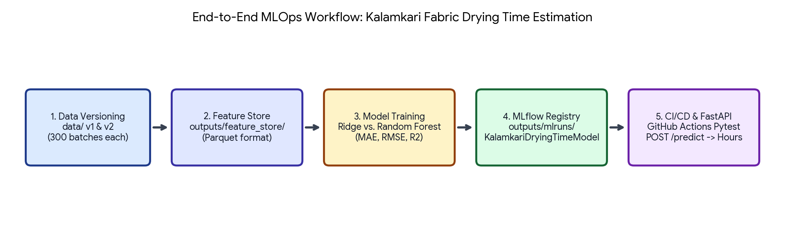

# Kalamkari_Drying_Time

End-to-end MLOps pipeline for estimating drying duration (in hours) for hand-printed Kalamkari fabrics near Machilipatnam.



## Folder Structure
```text
Kalamkari_Drying_Time/
├── .github/workflows/ci.yml        # GitHub Actions CI/CD tests
├── data/                           # Versioned datasets (v1 normal, v2 monsoon)
├── docs/                           # PDF report, workflow diagram, comparison chart
├── notebooks/                      # Jupyter/Colab experiment notebook
├── outputs/                        # Generated runtime artifacts (feature_store/, models/, mlruns/, metrics_report.json)
├── src/                            # Modular pipeline (features.py, train.py, app.py)
├── tests/                          # Automated pytest suite (test_app.py)
├── requirements.txt
└── README.md
```

## Quickstart
```bash
pip install -r requirements.txt
python -m src.train
pytest -v tests/test_app.py
uvicorn src.app:app --reload
```
